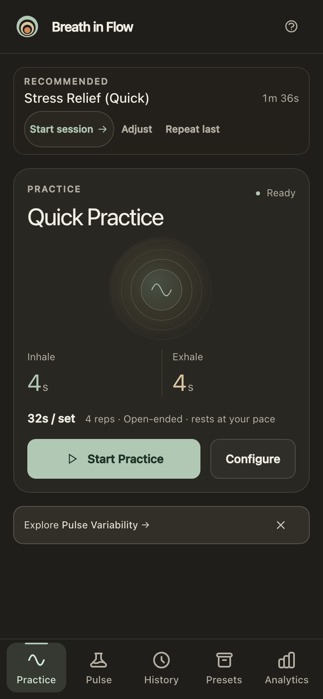
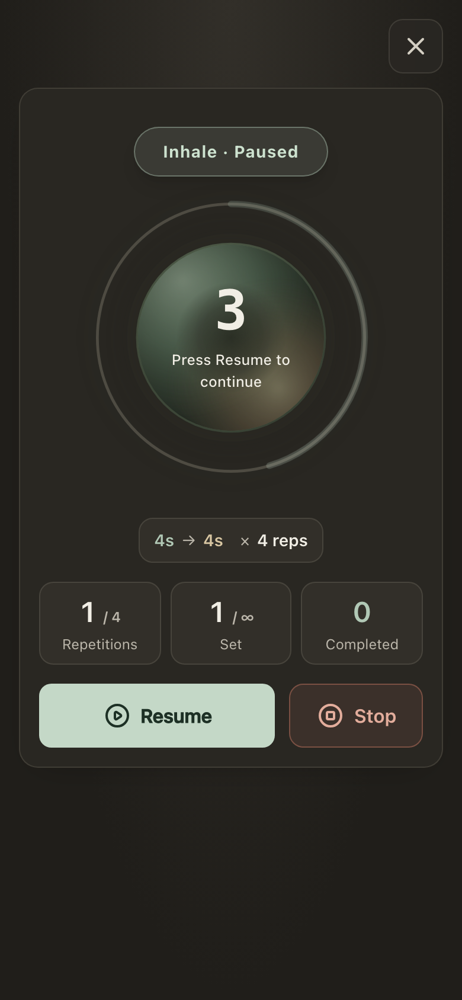
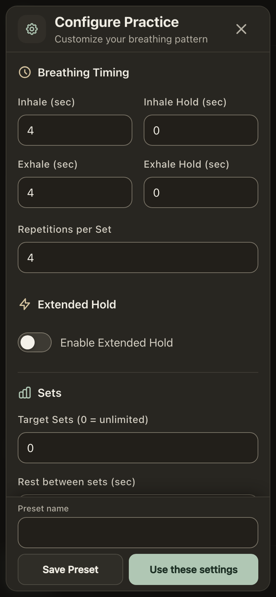
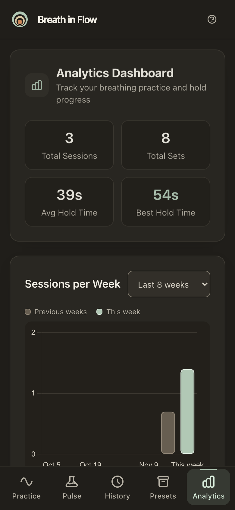
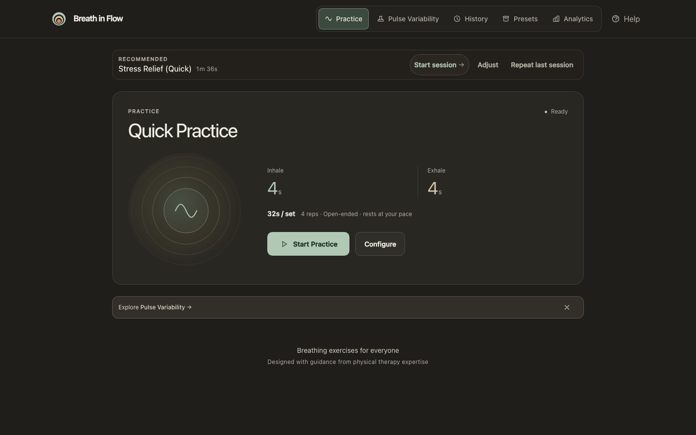

<p align="center">
  
</p>

<h1 align="center">Breath in Flow</h1>
<p align="center"><strong>Find your breathing rhythm.</strong></p>
<p align="center">Guided breathing routines, hold tracking, and optional pulse variability checks on phone, desktop, or browser.</p>
<p align="center">
  <a href="#get-started">Get started</a> ·
  <a href="#install-on-your-phone">Install on your phone</a> ·
  <a href="#app-store-and-privacy">Privacy &amp; store readiness</a> ·
  <a href="#develop-and-contribute">Contribute</a>
</p>

Take a structured breathing break while Breath in Flow handles the pace, holds, and sets. Pick a guided routine or tune every phase to match your comfort, altitude, and goals. Everything runs offline and stays on your device.

<p align="center">
  
  
  
  
</p>

<p align="center">
  
</p>

## What it does

- **Start quickly with guided routines.** Built-in presets cover Box Breathing, Coherent Breathing, 4-7-8 Relaxation, Altitude Adapted 3-5-7, Stress Relief, and Diaphragm Resistance Training. Save, edit, and repeat custom presets from the Routine Library.
- **Follow visual, sound, and voice cues.** An expanding breathing guide, five synthesized Web Audio themes, and bundled offline voice cues lead each phase. Active sessions pause automatically if you switch away on iOS or Android.
- **Customize every phase and hold.** Adjust inhale, hold, exhale, and rest timings, configure timed or tolerance-based extended holds (including a second hold phase), and set target sets.
- **Track progress locally.** Session History records completed sets, full breathing patterns, extended holds, notes, and optional before-and-after feeling check-ins. Analytics charts weekly sessions and hold-time trends across completed sessions.
- **Explore Pulse Variability (optional).** Measure seated pulse variability using your phone's camera or chest motion sensors, or run a five-rate breathing response assessment to suggest a comfortable practice cadence.
- **Own your data.** Breath in Flow requires no account and sends no telemetry. Export a local JSON backup, restore on a new device, or erase all local data in one step from **Help → Data**.

## Get started

1. Choose a starting goal during onboarding and open **Practice**.
2. Start the recommended routine, load a preset from **Presets**, or open **Configure** to customize timings and audio cues.
3. Tap **Start Practice** and follow the guide. Press **Space** or **Enter** on desktop to release an active tolerance hold.

Review past sessions in **History**, trends in **Analytics**, and backup, restore, privacy, and data-erasure tools under **Help → Data**.

Desktop installers for macOS (Apple Silicon and Intel), Windows, and Linux are published under [Releases](https://github.com/doublesharp/breath-in-flow/releases) and built by [Build &amp; Release](https://github.com/doublesharp/breath-in-flow/actions/workflows/release.yml).

## Install on your phone

### Android APK (GitHub Actions)

GitHub Actions builds an installable Android APK automatically on every `v*` tag push and on manual runs of [Build &amp; Release](https://github.com/doublesharp/breath-in-flow/actions/workflows/release.yml).

1. Sign in to GitHub and open [Build &amp; Release](https://github.com/doublesharp/breath-in-flow/actions/workflows/release.yml).
2. Open a completed run and download **android-build** from **Artifacts** (or click **Run workflow** on `main` to build the latest commit).
3. Unzip the archive and open the `breath-in-flow-*.apk` file on your phone.
4. Allow **Install unknown apps** when prompted, then tap **Install**.

You can also download an APK from a tagged [Release](https://github.com/doublesharp/breath-in-flow/releases). For signed Google Play App Bundles (`.aab`), run `pnpm android:aab` with your local signing credentials configured as described in [docs/APP_STORE_COMPLIANCE.md](docs/APP_STORE_COMPLIANCE.md).

### iPhone and iPad (Xcode)

GitHub Actions does not currently build signed iOS archives. Build and install on an iPhone or iPad from a Mac with Xcode and an Apple account after [setting up the project](#develop-and-contribute):

```bash
pnpm build:ios
pnpm --filter @breath-in-flow/web exec cap open ios
```

Connect your device, choose your team under **Signing &amp; Capabilities**, select your phone as the destination, and click **Run**. Enable **Developer Mode** on the phone if prompted. See [CONTRIBUTING.md#iphone](CONTRIBUTING.md#iphone) for signing details.

## App Store and privacy

Breath in Flow is designed for general wellness and relaxation. It is not a medical device and is not intended to diagnose, treat, cure, or prevent any medical condition. Never practice breath holds in water, while driving, or if you feel dizzy.

- Standalone privacy policy page: [packages/web/public/privacy.html](packages/web/public/privacy.html)
- Apple App Store and Google Play submission checklist, privacy manifest details, and signing setup: [docs/APP_STORE_COMPLIANCE.md](docs/APP_STORE_COMPLIANCE.md)

## Develop and contribute

Breath in Flow is a pnpm workspace built with Vue 3, TypeScript, Vite, TailwindCSS, Zod, Capacitor, and Electron. Shared packages contain the breathing timer state machine, schemas, and signal-processing utilities.

Use the Node.js and pnpm versions defined in [package.json](package.json) via Corepack:

```bash
git clone https://github.com/doublesharp/breath-in-flow.git
cd breath-in-flow
corepack enable
pnpm install
pnpm dev
```

Open **http://localhost:7080**. Installing dependencies generates the Prisma client, and `pnpm dev` builds the shared package before starting Vite.

Run checks before opening a pull request against `main`:

```bash
pnpm typecheck
pnpm lint
pnpm test
pnpm build
```

See [CONTRIBUTING.md](CONTRIBUTING.md) for mobile setup, Playwright end-to-end tests, platform builds, and workspace layout.
