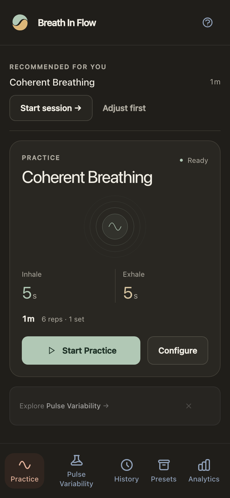
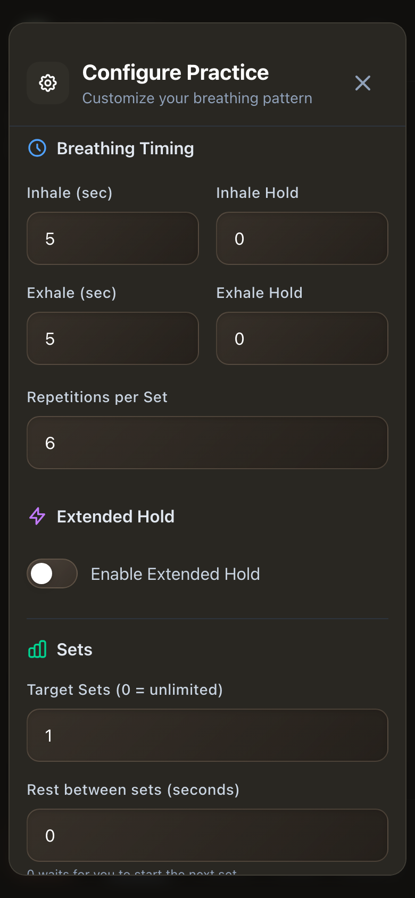
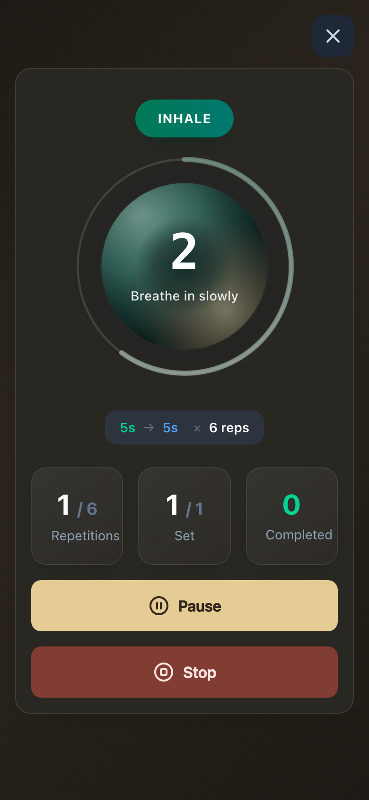

<p align="center">
  
</p>

<h1 align="center">Breath in Flow</h1>
<p align="center"><strong>Find your breathing rhythm.</strong></p>
<p align="center">Guided breathing, at your pace. On your phone, desktop, or browser.</p>
<p align="center">
  <a href="#get-started">Get started</a> ·
  <a href="#install-on-your-phone">Install on your phone</a> ·
  <a href="#develop-and-contribute">Contribute</a>
</p>

Make room for a breathing break without watching the clock or counting every breath. Choose a routine, follow the moving guide, and let Breath in Flow handle the timing. Adjust the pace, holds, and repetitions until the practice feels like yours.

<p align="center">
  
  
  
</p>

## Why use it?

- **Start with a routine.** Box breathing, coherent breathing, 4-7-8, and guided diaphragm training give you a starting point. Save your own presets and repeat a favorite session in a tap.
- **Practice without counting.** An animated guide, sound cues, and offline voice guidance lead you through each phase.
- **Set your own pace.** Change inhale and exhale timing, add holds, choose repetitions and sets, and take timed recovery breaks.
- **See your practice grow.** Session history, hold-time charts, and optional feeling check-ins help you follow your progress.
- **Explore your rhythm.** The Pulse Variability Lab uses your phone's camera or motion sensors to explore pulse variability and breathing resonance.
- **Keep your data yours.** No account or telemetry. Practice works offline, and your history stays on your device. Export a backup whenever you want.

## Get started

1. Choose a goal and open **Practice**.
2. Use the recommended routine, pick one from **Presets**, or open **Configure practice**.
3. Tap **Start Practice** and follow the guide. Pause or finish whenever you need.

Find your past sessions in **History**, trends in **Analytics**, and backup, restore, and feedback under **Data & support**.

Desktop downloads for macOS, Windows, and Linux are available through [Releases](https://github.com/doublesharp/breath-in-flow/releases). Development builds are available in [Build & Release](https://github.com/doublesharp/breath-in-flow/actions/workflows/release.yml).

## Install on your phone

### Android development build

You can install the APK directly, without Android Studio.

1. Sign in to GitHub and open [Build & Release](https://github.com/doublesharp/breath-in-flow/actions/workflows/release.yml).
2. Select a successful run, then download **android-build** from **Artifacts**. To build the current code, select **Run workflow**, choose `main`, and leave the version field empty.
3. Unzip the download and open the `breath-in-flow-*.apk` file on your phone.
4. When Android asks, allow your browser or file manager to **Install unknown apps**, then tap **Install**.

You can also download an APK from a release's assets. To install your own local changes, follow the [Android developer setup](CONTRIBUTING.md#android).

### iPhone development build

Install from a Mac with Xcode and an Apple account. After [setting up the project](#develop-and-contribute):

```bash
pnpm build:ios
pnpm --filter @breath-in-flow/web exec cap open ios
```

Connect your iPhone, select your team under **Signing & Capabilities**, choose your phone as the run destination, and click **Run**. Enable **Developer Mode** on the phone when prompted. The [iPhone setup guide](CONTRIBUTING.md#iphone) covers signing and rebuilding after changes.

## Develop and contribute

The app uses Vue, TypeScript, and Vite, with Capacitor for phones and Electron for desktop. Shared packages contain the breathing timer, validation, and signal analysis.

Use a Node.js version supported by [`package.json`](package.json) and the pnpm version pinned there through Corepack.

```bash
git clone https://github.com/doublesharp/breath-in-flow.git
cd breath-in-flow
corepack enable
pnpm install
pnpm dev
```

Open **http://localhost:7080**. The install generates the Prisma client, and the dev command builds the shared package before starting the app.

For a contribution, branch from `main`, make a focused change, and open a pull request back to `main`. Useful contributions include clearer routines, accessibility improvements, device testing, and fixes backed by a regression test.

```bash
pnpm test
pnpm typecheck
pnpm lint
pnpm build
```

See [CONTRIBUTING.md](CONTRIBUTING.md) for phone setup, browser tests, platform builds, and the project layout. For a bug report, include the steps to reproduce it, your device and OS, and what you expected to happen.
